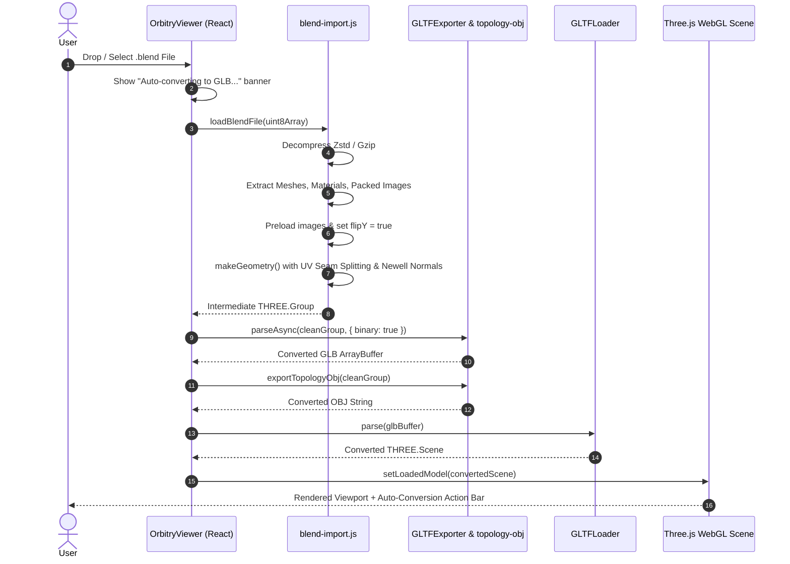

# Orbitry Architecture Documentation

## 1. System Overview

Orbitry is a client-side 3D asset previewer and converter built with **Next.js**, **React**, and **Three.js**. It enables users to directly inspect, preview, and convert `.blend` (Blender 3.x, 4.x, 5.x), `.glb`, `.gltf`, and `.obj` files directly inside modern web browsers with zero server-side uploads—ensuring 100% privacy, speed, and offline capability.

```
+-----------------------------------------------------------------------------------+
|                                 CLIENT BROWSER                                    |
|                                                                                   |
|  [ User Upload / Drop / Template ]                                               |
|               |                                                                   |
|       +-------v--------+                                                          |
|       |  .blend file   |                                                          |
|       +-------+--------+                                                          |
|               |                                                                   |
|  +------------v----------------------------------------------------------------+  |
|  |                     ORBITRY CONVERSION & IMPORT ENGINE                      |  |
|  |                                                                             |  |
|  |  1. Unpack & Decompress (fzstd Zstandard / DecompressionStream Gzip)        |  |
|  |  2. SDNA / AttributeStorage Extraction (Blender 3.x, 4.x, 5.x)              |  |
|  |  3. Clean Geometry & UV Seam Splitting (No distortion / No seam overlap)    |  |
|  |  4. Asynchronous Texture Loading & Y-Axis Orientation Alignment             |  |
|  |  5. Automated GLB (glTF 2.0) Conversion via GLTFExporter (Best Option)      |  |
|  |  6. Parallel Wavefront OBJ Generation (Preserving Polygon Topology)        |  |
|  +------------------------------------+----------------------------------------+  |
|                                       |                                           |
|       +-------------------------------+-------------------------------+           |
|       | (Primary: Web Preview & PBR)                                  | (Topology)|
|  +----v--------------------+                                     +----v--------+  |
|  |  GLTFLoader (Three.js)  |                                     |  OBJLoader  |  |
|  |  - Verified GLB buffer  |                                     |  - Quads /  |  |
|  |  - Upright Textures     |                                     |    N-gons   |  |
|  |  - Full PBR Materials   |                                     |  - Topology |  |
|  +----+--------------------+                                     +----+--------+  |
|       |                                                               |           |
|       +-------------------------------+-------------------------------+           |
|                                       |                                           |
|  +------------------------------------v----------------------------------------+  |
|  |                          THREE.JS VIEWPORT ENGINE                           |  |
|  |  - 4 Shading Modes: Solid | Material Preview | Render | Wireframe           |  |
|  |  - Camera Orbit Controls, Track to Object, Auto-Rotate, Grid, Shadows      |  |
|  |  - Clean Viewport Experience + Convert Menu (Format Switcher & Downloads)   |  |
|  +-----------------------------------------------------------------------------+  |
+-----------------------------------------------------------------------------------+
```

---

## 2. Core Architectural Mechanism: Automated Conversion on Import

### 2.1 The Problem in Legacy Direct Preview
In earlier iterations, `.blend` files were loaded directly into custom Three.js `BufferGeometry` structures. This presented critical limitations:
1. **Texture Inversion**: Textures appeared vertically upside-down (`flipY` mismatch between OpenGL UV origins and WebGL image row indexing).
2. **UV Seam Bleeding & Overlap**: UVs were mapped per shared vertex index. Vertices lying on UV seams had their texture coordinates collapsed to a single corner's UV, causing massive texture stretching, tears, and overlapping artifacts.
3. **Lack of Standard Web Interoperability**: Direct internal scene graphs could not be validated against web 3D standards or shared easily with external tools.

### 2.2 The New Automated Conversion Mechanism
When any `.blend` file is loaded (via file picker, drag-and-drop, or template slot):
1. **Immediate Ingestion**: Orbitry receives the `.blend` file bytes and triggers the conversion pipeline with responsive UI status indicators.
2. **Intermediate Scene Construction**: Decompresses and extracts legacy SDNA or Blender 5 `AttributeStorage` structures into an internal normalized scene graph.
3. **Optimal Format Selection (GLB - glTF 2.0 Binary)**:
   - **Why GLB is the best option**: GLB packages geometry, vertex normals, UVs, scene hierarchy, PBR properties (roughness, metalness, emission, alpha), and binary embedded PNG/JPEG textures into a single self-contained binary file. It is the gold standard for web 3D graphics (Khronos Group standard).
   - The intermediate scene is converted into a binary GLB blob via `GLTFExporter` (`binary: true`, `embedImages: true`).
4. **Topology-Preserving OBJ Generation**:
   - In parallel, an OBJ string is generated via `exportTopologyObj` preserving original quad and n-gon face loops for users prioritizing topology inspection.
5. **Standardized Viewport Preview**:
   - The converted GLB is parsed via `GLTFLoader` and loaded into the Three.js viewport.
   - This guarantees that what the user previews is the verified, standards-compliant converted asset.
6. **Cached Artifacts & 1-Click Exports in Convert Menu**:
   - The converted GLB buffer and OBJ string are stored in memory without cluttering the main 3D viewport.
   - When users open the **Convert** menu, they can instantly download either format (`⬇ Download Converted GLB` / `⬇ Download Converted OBJ`) and toggle viewport views (`View GLB` / `View OBJ`).

---

## 3. Data Flow & Processing Stages



---

## 4. Texture Orientation & UV Correction Pipeline

### 4.1 Root Cause of Upside-Down Textures
- **Image Memory Layout**: Standard image files (PNG, JPEG) store pixels in top-down row order (row 0 is the top edge).
- **Blender UV Convention**: Blender's UV coordinate system places $(U=0, V=0)$ at the **bottom-left** and $(U=1, V=1)$ at the **top-right**.
- **WebGL Default**: If `texture.flipY` is set to `false`, WebGL does not flip the image rows during GPU upload. Row 0 (top of image) is mapped to $V=0$ (bottom of mesh), causing the rendered texture to be completely inverted vertically.
- **GLTF Standard**: The glTF 2.0 specification defines texture coordinates with the origin $(0, 0)$ at the **top-left**.

### 4.2 The Solution
1. **Preloaded Texture Acquisition**:
   All packed textures in the `.blend` file are extracted from binary image blocks and preloaded asynchronously into `HTMLImageElement` instances using `Promise.all`:
   ```javascript
   const img = new Image();
   img.onload = () => {
     const texture = new THREE.Texture(img);
     texture.colorSpace = THREE.SRGBColorSpace;
     texture.flipY = true; // WebGL flips row 0 to V=1, matching Blender UV space
     texture.wrapS = THREE.RepeatWrapping;
     texture.wrapT = THREE.RepeatWrapping;
     texture.needsUpdate = true;
     resolve(texture);
   };
   ```
2. **GLTFExporter Compliance**:
   When `GLTFExporter` runs, it inspects `texture.flipY`. Because `flipY === true`, it applies a canvas flip transform (`ctx.translate(0, height); ctx.scale(1, -1)`) so the exported glTF texture data conforms to the glTF 2.0 top-down specification.
3. **GLTFLoader Verification**:
   When `GLTFLoader` loads the resulting GLB, it sets `texture.flipY = false`. The texture renders 100% upright in both Orbitry and external glTF viewers.

---

## 5. Geometry Synthesis & Topology Preservation

### 5.1 UV Seam Splitting (`makeGeometry`)
In Blender, UV coordinates are defined per corner (loop vertex), while vertex positions are shared across adjacent faces. To eliminate texture stretching and overlap across UV seams:
1. For each corner of every face, a composite hash key is generated:
   $$\text{key} = \text{posIndex} + \text{"\_"} + \text{round}(u \times 10^5) + \text{"\_"} + \text{round}(v \times 10^5)$$
2. Corners sharing the same 3D position and the same UV coordinates share the same buffer index.
3. Corners across UV seams (different UVs at the same 3D coordinate) are cleanly split into distinct buffer vertices.
4. Triangles obtain exact corner UV coordinates without seam distortion or cross-face bleeding.

### 5.2 Consistent Polygon Loop Fan Triangulation & Double-Sided Rendering
To prevent missing faces ("face bolong") and inverted normal holes on non-convex or curved surfaces:
1. Polygon loops in Blender maintain counter-clockwise perimeter order. Fan triangulation $(0, i, i+1)$ preserves this exact loop orientation across all polygons without destructive per-triangle swapping.
2. `THREE.DoubleSide` is systematically enforced across all materials (Solid mode, Material Preview, Render mode, and converted GLB/OBJ models) matching Blender's default viewport behavior (backface culling OFF), ensuring single-sided sheets, inner mug walls, nori wrap, and curved surfaces render cleanly from all angles.

### 5.3 Seamless Normal Smoothing Across UV Splits
When vertices are split along UV seams, naive normal computation would create sharp lighting seams. Orbitry resolves this by:
1. Accumulating triangle face normals per **original 3D position**.
2. Normalizing the accumulated normal for each 3D position.
3. Assigning the smoothed normal to all split vertices sharing that 3D position.
4. Result: 100% continuous, smooth shading across all UV seams.

### 5.4 Quad & N-gon Preservation for OBJ
Original polygon face loops are stored in `geometry.userData.originalTopology.faces`. When exported via `exportTopologyObj`, faces are written as original quads or n-gons (`f v1/vt1/vn1 v2/vt2/vn2 v3/vt3/vn3 v4/vt4/vn4`), keeping topology clean for 3D modeling workflows.

---

## 6. Directory Structure

```
Orbitry/
├── app/
│   ├── globals.css           # Styling, themes (Dark, Studio, Light), conversion banner
│   ├── layout.tsx            # HTML document root and metadata
│   └── page.tsx              # Main entry point importing OrbitryViewer
├── components/
│   └── OrbitryViewer.tsx     # 3D viewport, conversion coordinator, UI panels
├── lib/
│   ├── blend-import.js       # Blender binary unpacker, SDNA parser, geometry synthesis
│   └── topology-obj.js       # Wavefront OBJ exporter with quad topology & UV support
├── public/
│   └── templates/            # Bundled example .blend models
│       ├── fantasy-fish.blend
│       ├── sushi-sashimi.blend
│       └── tedung-keraton.blend
├── scripts/
│   └── test-blend.mjs        # Automated CLI test suite for Blender imports
├── architecture.md           # System architecture documentation
├── design.md                 # UI/UX, shading, and interaction design specification
├── package.json              # Dependencies and build scripts
└── tsconfig.json             # TypeScript configuration
```
